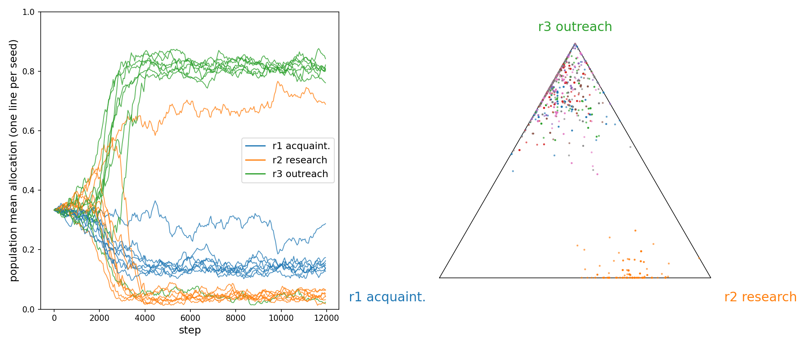

# 学会で有名になる戦略

研究者ネットワーク上で「有名さ = グラフの中心性」と定義し、限られた資源の最適な配分をシミュレーションで探す数理モデリングのプロジェクトです。

資源の使い道は 3 つです。

| 戦略 | 張る力の関数形 | リンクを張る相手 |
|---|---|---|
| 知り合い | 飽和型で増加 | 知り合いの知り合い |
| 研究 | 線形で増加 | 同じ学術ラベルの研究者 |
| アウトリーチ | 長く低く、最後に急増 | 全員の中からランダム |

張る力は、各戦略へのこれまでの投資の累積で決まります。毎ステップ、各リンクは一定の確率で切れ、リンクがなくなった研究者は退場します。

## 3 つのモデル

1. **全員がランダムな配分で固定**: 配分と有名さの関係を地形として描きます。
2. **自分だけが学習**: 他の人の配分は固定し、試行錯誤で配分を変える 1 人がどこに行き着くかを見ます。
3. **全員が学習**: 全員が隣人の成功をまねて配分を変えたとき、集団がどこに落ち着くかを見ます。

モデルの式、パラメータ、学習規則の詳細は [DESIGN.md](DESIGN.md) にあります。

## フォルダ構成

```
summ_sch/
├── README.md        このファイル
├── DESIGN.md        設計書 (モデル定義、パラメータ、結果のまとめ)
├── src/             シミュレーションと解析のソースコード
├── notebooks/       結果を見るための Jupyter ノートブック
└── results/         計算結果 (図、数値、保存したシミュレーション)
```

### src/ ソースコード

| ファイル | 内容 |
|---|---|
| `sim.py` | モデル本体。ネットワーク、張る力の関数形、リンクの生成と切断、死亡、2 種類の学習 (山登りと模倣) |
| `run_experiments.py` | 3 モデルをまとめて実行し、`results/` 直下に図と `summary.json` を出す |
| `plot_network.py` | 3 モデルの最終状態のネットワーク図を描く |
| `model2_tools.py` | モデル 2 の解析用の関数 (配分を固定した実行、学習の実行、平均場近似) |
| `model2_compute.py` | モデル 2 の重い計算 (最適反応の総当たり、学習の比較) を行い `results/model2/` に保存する |
| `model3_tools.py` | モデル 3 の解析用。戦略の系譜 (誰が誰をまねたか、突然変異) を記録する |
| `model3_compute.py` | モデル 3 を多数のシードで記録付きで回し `results/model3/` に保存する |

### notebooks/ ノートブック

| ファイル | 内容 | 読み込む結果 |
|---|---|---|
| `summ_sch.ipynb` | 3 モデルを最初から実行して、主な図を一通り描く入門用 | なし (その場で計算) |
| `model2_analysis.ipynb` | モデル 2 の詳しい解析。最適反応の地形、平均場近似、時間スケール、学習が失敗する理由 | `results/model2/` |
| `model3_analysis.ipynb` | モデル 3 の詳しい解析。行き先、有名人の戦略の推移、頻度依存性、有名さの持続性、勝った戦略の系譜 | `results/model3/` |

解析用の 2 つのノートブックは、保存済みの結果を読み込むだけです。先に対応する計算スクリプトを実行してください。

### results/ 計算結果

| 場所 | 内容 | 作るスクリプト |
|---|---|---|
| `results/*.png`, `results/summary.json` | 3 モデルの主な図と数値 | `run_experiments.py`, `plot_network.py` |
| `results/model2/` | モデル 2 の総当たりと学習の結果 (`grid.npz`, `learn.npz`)、数値のまとめ、ノートブックから書き出した図 (`fig/`) | `model2_compute.py` |
| `results/model3/` | モデル 3 の 16 シード分の記録 (`run_*.npz`)、ノートブックから書き出した図 (`fig/`) | `model3_compute.py` |

## 実行方法

Python 3.10 以上と numpy、networkx、matplotlib、pandas、scipy が必要です。ノートブックには Jupyter も必要です。

```bash
pip install numpy networkx matplotlib pandas scipy jupyter

python3 src/run_experiments.py            # 3 モデルの主な図 (16 コアで約 2 分)
python3 src/plot_network.py               # 最終状態のネットワーク図
python3 src/model2_compute.py all 12      # モデル 2 の解析用の計算 (12 シードで約 25 分)
python3 src/model3_compute.py 16 12000    # モデル 3 の解析用の計算 (16 シードで約 2 分)
```

`run_experiments.py --quick` は少数シードでの動作確認用です。結果は同じ場所に上書きされます。
並列計算に fork を使うので、Linux、macOS、WSL で動きます。

## 主な結果

- **モデル 1**: アウトリーチを多めにして、知り合いも 2〜3 割残す配分が最も有名になりました。

  

- **モデル 2**: 1 人の最適な配分は、アウトリーチ 9 割、知り合い 1 割でした。研究寄りにも小さな山があり、均等配分はその間の谷にあります。試行錯誤の学習では雑音が大きすぎて、最適点にたどり着けませんでした。
- **モデル 3**: 模倣学習の集団は、16 シード中 12 シードでアウトリーチ型、4 シードで研究型にまとまりました。アウトリーチを先に使った人が有名になり、まねされて広がります。全員が同じ戦略になった後は、誰が有名になるかはほぼ運で決まります。

  

詳しくは [DESIGN.md](DESIGN.md) と各ノートブックのまとめを参照してください。
