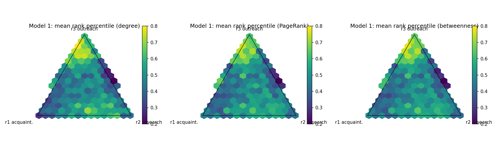

# 学会で有名になる戦略

研究者ネットワーク上で「有名さ = グラフの中心性」と定義し、限られた資源の最適な配分をシミュレーションで探す数理モデリングのプロジェクトです。

資源の使い道は 3 つです。

| 戦略 | 張る力の関数形 | リンクを張る相手 |
|---|---|---|
| 知り合い | 飽和型で増加 | 知り合いの知り合い |
| 研究 | 線形で増加 | 同じ学術ラベルの研究者 |
| アウトリーチ | 長く低く、最後に急増 | 全員の中からランダム |

張る力は、各戦略へのこれまでの投資の累積で決まります。毎ステップ、各リンクは一定の確率で切れ、リンクがなくなった研究者は退場します。

## 3 つのモデル

1. **全員がランダムな配分で固定**: 配分と有名さの関係を地形として描きます。
2. **自分だけが学習**: 他の人の配分は固定し、試行錯誤で配分を変える 1 人がどこに行き着くかを見ます。
3. **全員が学習**: 全員が同時に配分を変えたとき、集団がどこに落ち着くかを見ます。

モデルの式、パラメータ、学習規則の詳細は [DESIGN.md](DESIGN.md) にあります。

## 実行方法

Python 3.10 以上と numpy、networkx、matplotlib が必要です。

```bash
pip install numpy networkx matplotlib
python3 src/run_experiments.py           # 本番 (16 コアで約 1 分)
python3 src/run_experiments.py --quick   # 少数シードでの動作確認
```

結果は `results/` に保存されます。`--quick` でも同じ場所に上書きされます。

## ファイル構成

```
DESIGN.md               設計書 (モデル定義、パラメータ、予備結果)
src/sim.py              モデル本体
src/run_experiments.py  3 モデルの実験と作図
results/                図と数値のまとめ (summary.json)
```

## 予備結果

既定パラメータでは、アウトリーチを多めにして知り合いも 2〜3 割残す配分が最も有名になりました。



一方、試行錯誤で学習する研究者は、この最適配分にうまく収束しませんでした。報酬のノイズに対して地形の傾きが緩いためと考えられます。詳しくは [DESIGN.md](DESIGN.md) の予備結果と今後の検討事項を参照してください。
